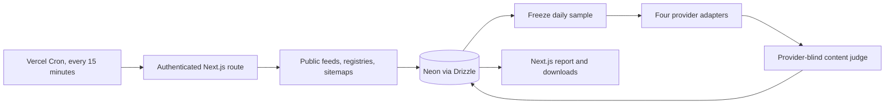

# Scraping Bench

Daily comparison of Context, Exa, Firecrawl, and Keenable on the same pages. The report shows useful content, response time, category coverage, history, and downloadable individual results.

## Architecture



Production uses Vercel Functions and Vercel Cron, with Drizzle-managed PostgreSQL on Neon. No separate worker, publication bridge, local database, or export scheduler is required. `src/lib/benchmark/collect.ts` owns durable work; provider and discovery adapters handle external formats; the report queries the same database.

Copy `.env.example` to `.env.local`, configure the secrets, run `npm ci`, then `npm run db:migrate` and `npm run dev`. Use a pooled Neon connection URL with TLS in production. `DATABASE_URL` is also used by Drizzle Kit. Deploy through the connected Vercel project.

Set a randomly generated `CRON_SECRET` of at least 32 bytes in Vercel production. Vercel sends it in the Authorization header. The cron fails closed before accessing the database, refuses preview execution, and only collects with `TRACE_WORKER_ENABLED=1`. Keep provider keys production-only. Do not pass credentials in URLs.

A database lease excludes concurrent ticks. Each request reserves its daily budget before dispatch, and writes require its current claim. Expired provider dispatches become unresolved rather than being repeated; grading can retry once. Every tick reconciles outstanding work, so a missed invocation does not lose the queue. A new daily sample does not depend on the previous sample finishing.

## Protocol and storage

The `scraping-bench-v4` sample targets up to 300 unseen pages in each of eight categories after 00:15 UTC, reduced equally when the remaining daily request allowance is smaller. Discovery uses the source registry in `config/sources.json`; source polling continues throughout the day, with up to 48 due sources per tick and a 40-second deadline per source. The 15-minute scheduler is the minimum polling interval. Canonical URLs and document identities are deduplicated, with organization and hostname caps. All providers receive identical targets, fresh content requests, a 30-second deadline, and a 250,000-character normalized output limit. Context and Firecrawl request main content.

Jev 1.13.0 receives target metadata and up to 12,000 characters from the start, middle, and end, without the provider name. Substantive matching content is useful. A negative judgment from an incomplete excerpt remains unresolved. Scores average category rates equally; failed, unresolved, and pending results remain in the denominator, and a missing category withholds the overall score. Latency excludes authentication, credit, rate-limit, and interrupted-dispatch errors. This is not a ground-truth accuracy or full-recall benchmark.

Daily caps are 4,000 requests per provider and 120 million grading input tokens. Each call reserves a conservative UTF-8 byte upper bound including prompt overhead, then settles to reported input-token usage. Request reservations survive crashes. The collector processes bounded batches within a 300-second Vercel function. Provider charges are separate from database hosting.

Neon Free stores compressed private grading excerpts for up to seven days within 256 MB, and individual results for 30 days after their run is complete. Daily summaries and seen identities remain. Report responses are cached for 15 minutes, and hidden tabs do not poll, allowing Neon to suspend between scheduled work. The excerpt limit is not a total database-size cap; monitor Neon storage and compute usage. Historical summaries and decisions retain their original protocol, and the chart never joins different protocols. Pre-migration raw archives remain archival backups and are not needed by production.

`npm run db:migrate -- path/to/bootstrap.json.gz` can import the migration snapshot once: candidate inventory, seen identities, historical results, and the current day's provider budgets. Import before enabling collection to avoid repeating earlier requests. It never replaces existing records.

## Verification

Use a disposable local PostgreSQL database, then run:

```sh
DATABASE_URL=postgresql://localhost/benchmark_verify npm run test:e2e
npm run lint
npm run build
```

The E2E harness uses a real PostgreSQL database and HTTP provider fixtures. It exercises duplicate ticks, crash recovery, authentication, preview isolation, private-address rejection, request caps, Unicode, and public-data isolation. It produces `artifacts/rebuild/e2e.json`; CI retains this artifact. Fixture checks do not establish provider quality or live scheduler delivery.
